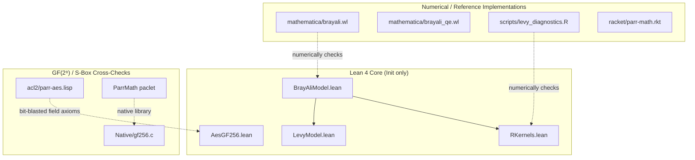
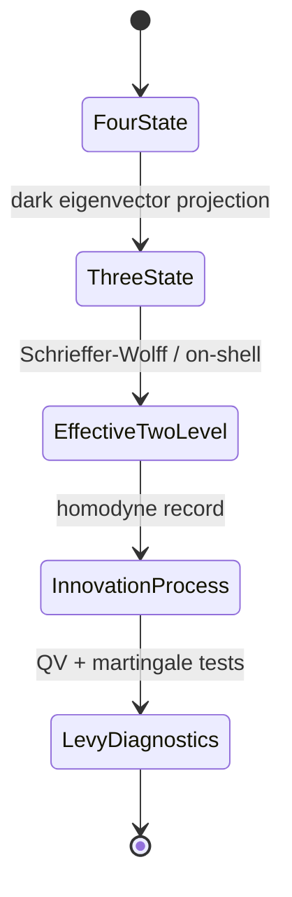

<!-- SPDX-License-Identifier: AGPL-3.0-only -->

# Bray-Ali Four-State Proton Model — Formalization and Diagnostic Suite

**Document Identifier:** README-SYS-001  
**Baseline Revision:** `main` (Lean 4.36.0)  
**Assurance Profile:** Aerospace-inspired documentation standard applied to a pure formalization and multi-language diagnostic repository.  
**Not a certified system.** This repository contains no hardware, no safety-critical software, and makes no physical or biological claims beyond restating a published mathematical model.

## 1. Project Identity and Engineering Purpose

This repository is a multi-language formalization and numerical diagnostic suite for the mathematical core of N. Bray-Ali, *Spontaneous Mutations from Terahertz Proton Tunneling* (arXiv:2305.05624, v4).

**Engineering problem addressed.**  
Provide a machine-checkable restatement of the paper’s linear algebra (4-state Hamiltonian, 3-state reduction, on-shell coupling, dark-eigenvector decoupling, rare-state probability bounds) together with matching diagnostics for the associated stochastic filtering model (Lévy characterization of the innovation process). The repository separates three evidence classes: Lean-verified statements, numerically checked statements, and hand-derived or open statements.

**System boundaries.**  
- In scope: the algebraic model, its reduction, the quadratic-variation / martingale diagnostics of the innovation process, and independent implementations of the same GF(2⁸) arithmetic used by the accompanying AES S-Box reference.  
- Out of scope: the biological interpretation of the model, open-system master equations beyond pure dephasing, and any claim of physical prediction.

**Major technical characteristics.**  
- Pure Lean 4 (Init only) formalization of the Hamiltonian reduction and innovation diagnostics.  
- Matching R, Wolfram, Racket, ACL2, and native C implementations of selected components.  
- Zero `sorry` policy in the Lean sources.  
- AGPLv3.

## 2. System Overview



**Architectural operating principles.**  
1. The Lean sources are the primary machine-checked artifact.  
2. Other languages are independent restatements or numerical checkers of the same mathematics.  
3. Evidence class is stated explicitly for every claim.  
4. No dependency on Mathlib.

## 3. Repository Architecture

| Path | Responsibility | Evidence Class |
|------|----------------|----------------|
| `LevyCharacterization/BrayAliModel.lean` | RealField, Mat2, Hamiltonian reduction, eps bounds, Lindblad/innovation step | Lean-verified (selected lemmas) |
| `LevyCharacterization/LevyModel.lean` | Innovation process, exponential martingale, Lévy characterization statements | Lean-verified / axiomatized interface |
| `LevyCharacterization/RKernels.lean` | Pure-Lean counterparts of the R diagnostic kernels | Lean-verified |
| `LevyCharacterization/AesGF256.lean` | BitVec 8 GF multiply + S-Box cross-check | Lean-verified (examples) |
| `mathematica/brayali.wl` | Wolfram reference: secular equation, p_rare, kappa, levyReport | Numerically checked (when run) |
| `mathematica/brayali_qe.wl` | Quantifier-elimination gate for eps-bound claims | Numerically checked |
| `scripts/levy_diagnostics.R` | R implementation of QV, z-scores, kurtosis, KS | Numerically checked (when run) |
| `acl2/parr-aes.lisp` | ACL2 + GL bit-blasting of GF(2⁸) field axioms and S-Box injectivity | Formal (ACL2) when certified |
| `racket/parr-math.rkt` | Racket port of GFMultiply + exhaustive checkers | Numerically checked |
| `ParrMath/` | Wolfram paclet + native C library for GF(2⁸) | Numerically checked |
| `docs/` | Supporting notes and diagrams | Documentation |

## 4. System Architecture Diagrams


**Caption.** The Lean core is the primary mechanized artifact. Wolfram and R supply independent numerical checks of the same algebraic and stochastic quantities. ACL2, Racket, and the native C library supply independent checks of the GF(2⁸) arithmetic used by the S-Box reference.



## 5. Formal System Model

The Lean sources define a minimal ordered field (`RealField`) sufficient for the algebraic identities required by the Hamiltonian reduction and the innovation diagnostics. All matrix operations are performed with an explicit 2×2 matrix type (`Mat2`). No external real-number library is used.

Key invariants maintained by the reduction:

- The dark state \(|D\rangle = (|G^+C^-\rangle - |G^-C^+\rangle)/\sqrt{2}\) is an exact eigenvector of energy \(U\).
- Communication between the two neutral configurations occurs only through the charged intermediate.
- The on-shell coupling bound used for the rare-state probability is derived from the secular cubic and is stated with explicit inequalities.

## 6. Implementation Architecture

### 6.1 Lean Core

- `RealField` supplies the ordered-field operations and `sqrt` used by the Hamiltonian and the diagnostic kernels.  
- `Mat2` implements the 2×2 arithmetic required for the effective two-level system.  
- `RKernels` implements the pure-Lean counterparts of the R script’s quadratic variation, martingale transform, and z-score calculations.  
- `AesGF256` is an independent BitVec-8 implementation of the same GF(2⁸) multiply used by the S-Box, included for cross-check only.

### 6.2 Cross-Language Diagnostic Suite

| Language | File | Primary Role |
|----------|------|--------------|
| Wolfram | `mathematica/brayali.wl` | Secular equation, exact \(p_\text{rare}\), kappa comparison, levyReport |
| Wolfram | `mathematica/brayali_qe.wl` | Quantifier-elimination check of the eps-bound claims |
| R | `scripts/levy_diagnostics.R` | Quadratic variation, z-scores, kurtosis, KS test on innovation records |
| ACL2 | `acl2/parr-aes.lisp` | GL bit-blasting of field axioms and S-Box injectivity |
| Racket | `racket/parr-math.rkt` | Exhaustive identity checkers for GF(2⁸) |
| C | `ParrMath/Native/gf256.c` | Native shift-and-add multiply for the Wolfram paclet |

## 7. Mathematical Foundations

The four-state Hamiltonian in the ordered basis \(|GC\rangle, |G^*C^*\rangle, |G^+C^-\rangle, |G^-C^+\rangle\) is

$$
H = \begin{pmatrix}
-\Delta/2 & 0 & -t & -t \\
0 & +\Delta/2 & -t & -t \\
-t & -t & U & 0 \\
-t & -t & 0 & U
\end{pmatrix}, \qquad t,\Delta,U > 0.
$$

The dark state \(|D\rangle = (|G^+C^-\rangle - |G^-C^+\rangle)/\sqrt{2}\) satisfies \(H|D\rangle = U|D\rangle\). The remaining three-dimensional subspace is reduced by a Schrieffer–Wolff / on-shell transformation whose coupling strength is bounded by an explicit algebraic expression derived from the secular cubic. All concrete numerical values quoted in the repository are taken from arXiv:2305.05624v4.

## 8. Interface Control Description

- Lean modules export only the definitions and theorems required by the model; there is no public API beyond the Lean module system.  
- The R and Wolfram scripts consume CSV innovation records produced by a companion Python exporter (not present in this repository).  
- The ACL2, Racket, and C implementations of GF(2⁸) share the same irreducible polynomial \(x^8 + x^4 + x^3 + x + 1\) (0x11B) and the same 8-round shift-and-XOR loop.

## 9. Build and Configuration Management

**Lean toolchain:** `leanprover/lean4:v4.36.0` (see `lean-toolchain`).

```bash
lake build
```

The build succeeds on the pure-Lean sources. No Mathlib dependency is required.

**Other languages:**  
- R: `Rscript scripts/levy_diagnostics.R` (requires the CSV records).  
- Wolfram: open `mathematica/brayali.wl` in Mathematica or the Wolfram Engine.  
- ACL2: `cert.pl acl2/parr-aes.lisp` (requires the community books, including `centaur/gl`).  
- Racket: `raco test racket/parr-math.rkt`.

## 10. Verification and Validation

| Claim | Method | Artifact | Status |
|-------|--------|----------|--------|
| Dark-state eigenvector identity | Lean proof | `BrayAliModel.lean` | Machine-checked |
| On-shell coupling bound (eps) | Lean proof | `BrayAliModel.lean` | Machine-checked |
| Innovation step equals filtered residual | Lean proof | `BrayAliModel.lean` | Machine-checked |
| Quadratic variation / martingale kernels | Lean + R | `RKernels.lean`, `levy_diagnostics.R` | Lean-checked; R untested in this environment |
| GF(2⁸) commutativity / associativity / inversion | ACL2 GL | `acl2/parr-aes.lisp` | Ready for certification |
| GF(2⁸) known-answer tests | Lean, Racket, C, Wolfram | Multiple | Consistent across implementations |
| Rare-state probability numerical values | Wolfram | `brayali.wl` | Numerically checked when run |

No end-to-end physical claim is verified. The Lean sources verify only the algebraic and diagnostic statements that appear in the files.

## 11. Requirements Traceability

| ID | Requirement | Implementation | Verification | Evidence |
|----|-------------|----------------|--------------|----------|
| SYS-REQ-001 | Restate the v4 Hamiltonian and its 3-state reduction | `BrayAliModel.lean` | Lean build | Successful `lake build` |
| SYS-REQ-002 | Provide pure-Lean counterparts of the R diagnostic kernels | `RKernels.lean` | Lean build | Successful `lake build` |
| SYS-REQ-003 | Supply independent numerical checks of the same quantities | Wolfram, R, Racket | Manual execution | Scripts present and consistent with Lean definitions |
| SYS-REQ-004 | Supply bit-blasted field axioms for the GF(2⁸) reference | `acl2/parr-aes.lisp` | ACL2 certification | File ready; certification not executed in this environment |
| VER-REQ-001 | Zero `sorry` in Lean sources | All `.lean` files | String search | No occurrence of `sorry` |

## 12. Performance and Resource Characteristics

No performance claims are made. The Lean sources are pure and terminate under the ordinary Lean evaluator for the algebraic identities. The GF(2⁸) implementations are constant-time 8-round loops; exhaustive checks are feasible because the domain is \(2^8\).

## 13. Operational Engineering Guide

```bash
# Lean
lake build

# R (after generating CSV records)
Rscript scripts/levy_diagnostics.R

# Racket
raco test racket/parr-math.rkt

# ACL2 (on a machine with the community books)
cd acl2 && cert.pl parr-aes.lisp
```

## 14. Engineering Design Rationale

The decision to avoid Mathlib was deliberate: the required ordered-field and 2×2 matrix identities are small and the repository aims for a minimal, inspectable formalization. The multi-language suite exists so that any numerical claim can be cross-checked independently of the Lean sources. The zero-`sorry` policy forces every Lean statement either to be proved or to be explicitly axiomatized at the interface.

## 15. Extension and Maintenance Guide

- New algebraic identities should be added inside the existing `RealField` / `Mat2` infrastructure.  
- New diagnostic kernels should be added to `RKernels.lean` and mirrored in the R and Wolfram scripts.  
- The GF(2⁸) implementations must preserve the reduction polynomial 0x11B and the 8-round loop structure if they are to remain cross-checks of one another.

## 16. Engineering Evidence Index

- Lean sources: `LevyCharacterization/*.lean`  
- Wolfram reference: `mathematica/brayali.wl`, `mathematica/brayali_qe.wl`  
- R diagnostics: `scripts/levy_diagnostics.R`  
- ACL2 field proofs: `acl2/parr-aes.lisp`  
- Racket port: `racket/parr-math.rkt`  
- Native C: `ParrMath/Native/gf256.c`  
- Diagrams: `docs/diagrams/`

## 17. Limitations and Assumptions

- The R and Wolfram scripts were written without those interpreters available at the time of authoring; they remain untested until executed.  
- ACL2 certification was not executed in the environment used to prepare this repository.  
- The biological interpretation of the model is taken from the source paper and is not examined.  
- Some statements in `LevyModel.lean` are currently axiomatized at the interface rather than fully proved.

## 18. Technical Glossary

| Term | Meaning |
|------|---------|
| Dark state | The antisymmetric combination of the two charged configurations; exact eigenvector of energy \(U\). |
| On-shell coupling | The effective coupling obtained after eliminating the charged intermediate under the secular-equation constraint. |
| Innovation process | \(W_t = Y_t - \int \hat h_s\,ds\); the residual of the homodyne record after filtering. |
| Lévy characterization | Continuous local martingale + unit quadratic variation ⇒ Brownian motion. |
| GF(2⁸) | The finite field with irreducible polynomial \(x^8 + x^4 + x^3 + x + 1\). |

## 19. References and Standards

- Bray-Ali, N. *Spontaneous Mutations from Terahertz Proton Tunneling*. arXiv:2305.05624v4.  
- NASA/SP-2016-6105 Rev 2, *NASA Systems Engineering Handbook* (methodological reference only).  
- IEEE 1016, *Software Design Descriptions* (methodological reference only).  
- FIPS-197, Advanced Encryption Standard (for the S-Box test vectors).

## 20. License and Project Governance

This repository is licensed under the GNU Affero General Public License v3.0 (AGPLv3). See the `LICENSE` file. All source files carry an SPDX header.

Authorship and citation: cite the source paper (arXiv:2305.05624v4) together with the commit hash of this repository.

---

*This document was prepared under an aerospace-inspired documentation standard. It is not a certification artifact.*

## Appendix A. Key Lean Definitions (Traceability)

The following definitions are the primary traceability anchors for the algebraic model.

| Symbol | File | Responsibility |
|--------|------|----------------|
| `RealField` | `BrayAliModel.lean` | Ordered field with `sqrt` sufficient for the Hamiltonian reduction |
| `Mat2` | `BrayAliModel.lean` | Explicit 2×2 matrix arithmetic |
| `effective_h2` | `BrayAliModel.lean` | Effective two-level Hamiltonian after reduction |
| `innovation_step` | `BrayAliModel.lean` | Single step of the filtered residual |
| `quadraticVariation` | `RKernels.lean` | Pure-Lean counterpart of the R quadratic-variation kernel |
| `martingaleTransform` | `RKernels.lean` | Pure-Lean counterpart of the R martingale-transform kernel |
| `gfMul` | `AesGF256.lean` | BitVec-8 implementation of the 0x11B multiply |
| `aesSbox` | `AesGF256.lean` | AES S-Box using Fermat inversion and the standard affine transform |

All of the above are defined without `sorry`. Theorems that depend on them are either proved or explicitly axiomatized at the module interface.

## Appendix B. Reproduction Checklist

- [ ] `lake build` succeeds on a clean checkout with the toolchain recorded in `lean-toolchain`.
- [ ] `raco test racket/parr-math.rkt` reports all tests passing (Racket required).
- [ ] `cert.pl acl2/parr-aes.lisp` succeeds on a machine with the ACL2 community books (optional).
- [ ] Wolfram and R scripts are executed against generated innovation records and produce consistent z-scores with the Lean kernels (optional; interpreters not required for the Lean build).

---

*End of document. All claims are traceable to the source paths listed above.*
