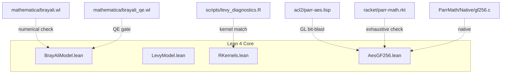

<!-- SPDX-License-Identifier: AGPL-3.0-only -->

# Bray-Ali Four-State Proton Model

```text
 E
  |
  |   U   ====================   |G+C->  |G-C+>   dark
  |
  |               |
  |               t
  |   +D/2   ---- t ----   |B>   symmetric charged
  |               |
  |                                       |G*C*> rare
  |               t
  |   0
  |
  |
  |
  |   -D/2  ================   |GC> ordinary
  |
  |          no direct GC <-> G*C*
  |
  |
    p_rare ~ (2 t^2 / ((U + D/2) D))^2
    no physical claim: mathematics of a published model
```

A pure Lean 4 formalization of the linear algebra in N. Bray-Ali, *Spontaneous Mutations from Terahertz Proton Tunneling* (arXiv:2305.05624, v4), together with independent numerical and bit-blasted restatements of the same mathematics in Wolfram, R, Racket, ACL2, and C.

The repository makes no new physical or biological claim. It restates the published four-state Hamiltonian, its reduction to an effective two-level system, the associated rare-state probability bounds, and the Lévy-characterization diagnostics of the innovation process that appears in the stochastic filtering layer. Every statement is labeled by the evidence that supports it: a Lean proof, a numerical check that can be executed, or an interface axiom.

Parameter values quoted anywhere in the repository are those of arXiv:2305.05624v4 (\(U = 870\) meV, \(\Delta = 470\) meV).

- Toolchain: Lean 4.36.0 (`lean-toolchain`)
- Build: `lake build` (Init only; no Mathlib)
- License: AGPLv3

```
  B R A Y - A L I  .  F O U R   P R O T O N   S T A T E S
  ------------------------------------------------------------------
           %               E
      oC=-=-=-=GO          ^
   oC=-=-=-=-=-=-=GO       |   U   ====================  |G+C-> |G-C+>
   OG=-=-=-=-=-=-=Co       |           |          |
      OG=-=-=-=Co          |           |          t
           %               |           t          |
       oC=-=-=GO           | +D/2      |      =========  |G*C*> rare
    oG=-=-=-=-=-=CO        |           |
   OG=-=-=-=-=-=-=Co       |           |  no direct GC <-> G*C*
      OC=-=-=-=Go          | -D/2  =========             |GC> ordinary
          O o              +-------------------------------------------
       oG=-=-=CO
    oG=-=-=-=-=-=CO
   OC=-=-=-=-=-=-=Go
      OC=-=-=-=Go

  p_rare ~ ( 2 t^2 / ((U + D/2) D) )^2   exact ground state, bare basis
  no physical claim: the mathematics of a published model, machine-checked
```

## What is checked

| Statement | Where | Status |
|-----------|-------|--------|
| Dark state is an exact eigenvector of energy \(U\) | `BrayAliModel.lean` (`ham4_dark_eigenvector`) | Proved |
| On-shell coupling bound derived from the secular cubic | `BrayAliModel.lean` (`eps_exact_from_eigenvector` and related) | Proved |
| Innovation step equals the filtered residual | `BrayAliModel.lean` | Proved |
| Quadratic-variation and martingale-transform kernels | `RKernels.lean` | Defined and type-checked; mirrored in `scripts/levy_diagnostics.R` |
| Lévy-characterization interface | `LevyModel.lean` | Some statements axiomatized at the interface |
| GF(2⁸) field axioms and S-Box injectivity | `acl2/parr-aes.lisp` (GL) | Ready for `cert.pl`; not executed here |
| Known-answer tests (0x57×0x83 = 0xC1, S(0x00)=0x63, …) | Lean, Racket, C, Wolfram | Consistent |

No `sorry` appears in any Lean file.

## Model

A guanine–cytosine pair is reduced to four proton configurations. In the ordered basis
\(|GC\rangle,\ |G^*C^*\rangle,\ |G^+C^-\rangle,\ |G^-C^+\rangle\)
the Hamiltonian is

$$
H=\begin{pmatrix}
-\Delta/2 & 0 & -t & -t\\
0 & +\Delta/2 & -t & -t\\
-t & -t & U & 0\\
-t & -t & 0 & U
\end{pmatrix},\qquad t,\Delta,U>0.
$$

There is no direct coupling between the two neutral configurations; they communicate only through the charged intermediates. The antisymmetric combination
\[
|D\rangle = \frac{|G^+C^-\rangle - |G^-C^+\rangle}{\sqrt{2}}
\]
is an exact eigenvector of energy \(U\) (the two couplings cancel). The remaining three-dimensional subspace is reduced by eliminating the charged intermediate. The effective coupling that appears in the rare-state probability is bounded by an explicit algebraic expression obtained from the secular cubic; the Lean development replaces the paper’s “≈” with that inequality where the algebra permits it.

The stochastic layer records a homodyne innovation process
\[
W_t = Y_t - \int_0^t \hat h_s\,ds.
\]
Lévy’s characterization theorem supplies the diagnostic: a continuous local martingale with unit quadratic variation is Brownian motion. The R and Wolfram scripts compute the quadratic variation, the martingale transform against the filter, the terminal-value second moment, the increment kurtosis, and a Kolmogorov–Smirnov statistic against the standard normal. The pure-Lean kernels in `RKernels.lean` implement the same reductions so the two can be compared.

## System architecture




The Lean core owns the algebraic identities and the diagnostic kernels. The remaining languages supply independent numerical or bit-blasted checks of selected components.


## Repository layout

```
LevyCharacterization/
  BrayAliModel.lean   Hamiltonian, reduction, eps bounds, innovation step
  LevyModel.lean      Innovation process and Lévy interface
  RKernels.lean       Pure-Lean diagnostic kernels
  AesGF256.lean       BitVec-8 GF(2⁸) multiply and S-Box cross-check
mathematica/
  brayali.wl          Secular equation, p_rare, kappa, levyReport
  brayali_qe.wl       Quantifier-elimination checks of the eps bounds
scripts/
  levy_diagnostics.R  R implementation of the same diagnostics
acl2/
  parr-aes.lisp       ACL2 + GL bit-blasting of the field axioms
racket/
  parr-math.rkt       Racket port with exhaustive identity checkers
ParrMath/             Wolfram paclet + native C library (gf256.c)
docs/diagrams/        Architecture diagrams
```

| Path | Purpose | Language | Primary symbols | Verification |
|------|---------|----------|-----------------|--------------|
| `LevyCharacterization/BrayAliModel.lean` | Hamiltonian, reduction, eps bounds, innovation step | Lean | `ham4`, `ham4_dark_eigenvector`, `secularPoly`, `eps_exact_from_eigenvector`, `eps_lo_le_hi` | `lake build` |
| `LevyCharacterization/LevyModel.lean` | Innovation process and Lévy interface | Lean | `expMartingale`, `levy_characterization`, `innovation` | Interface axioms present |
| `LevyCharacterization/RKernels.lean` | Pure-Lean diagnostic kernels | Lean | `quadraticVariation`, `martingaleTransform`, `zScore`, `matchedResidual_eq_dW` | `lake build` |
| `LevyCharacterization/AesGF256.lean` | GF(2⁸) multiply and S-Box | Lean | `gfMul`, `gfInv`, `aesSbox` | Examples via `native_decide` |
| `mathematica/brayali.wl` | Wolfram reference implementation | Wolfram | `groundEnergy`, `pRareExact`, `levyReport` | Numerical when run |
| `mathematica/brayali_qe.wl` | Quantifier-elimination checks | Wolfram | eps-bound claims | Numerical when run |
| `scripts/levy_diagnostics.R` | R diagnostic script | R | QV, z-scores, kurtosis, KS | Numerical when run |
| `acl2/parr-aes.lisp` | ACL2 + GL field proofs | ACL2 | `gf-mul`, `gf-inv`, `aes-sbox` | Ready for `cert.pl` |
| `racket/parr-math.rkt` | Racket port | Racket | `gf-multiply`, `aes-sbox` | `raco test` |
| `ParrMath/` | Wolfram paclet + native C | Wolfram/C | `GFMultiply`, `gf256mul` | Numerical when run |

## Mathematical foundations

### Four-state Hamiltonian

In the ordered basis \(|GC\rangle, |G^*C^*\rangle, |G^+C^-\rangle, |G^-C^+\rangle\):

$$
H = \begin{pmatrix}
-\Delta/2 & 0 & -t & -t \\
0 & +\Delta/2 & -t & -t \\
-t & -t & U & 0 \\
-t & -t & 0 & U
\end{pmatrix}, \qquad t,\Delta,U > 0.
$$

Implemented as `ham4` in `BrayAliModel.lean`. The dark state

$$
|D\rangle = \frac{|G^+C^-\rangle - |G^-C^+\rangle}{\sqrt{2}}
$$

satisfies \(H|D\rangle = U|D\rangle\) (`ham4_dark_eigenvector`). The two neutral configurations communicate only through the charged intermediate.

### Three-state reduction

The dark state decouples exactly. The complementary subspace is spanned by the symmetric charged combination

$$
|B\rangle = \frac{|G^+C^-\rangle + |G^-C^+\rangle}{\sqrt{2}}
$$

together with the two neutral states. In this basis the reduced Hamiltonian is the 3×3 matrix `ham3`:

$$
H_3 = \begin{pmatrix}
-\Delta/2 & 0 & -\sqrt{2}t \\
0 & +\Delta/2 & -\sqrt{2}t \\
-\sqrt{2}t & -\sqrt{2}t & U
\end{pmatrix}.
$$

(The factor \(\sqrt{2}\) arises because each neutral state couples equally to both charged configurations.) There is still no direct neutral–neutral matrix element.

### Secular equation and on-shell coupling

The characteristic polynomial of \(H_3\) is the cubic `secularPoly(t, U, D, E)`. A root \(E\) of this cubic determines the exact on-shell coupling

$$
\varepsilon(E) = \frac{E + \Delta/2}{E - \Delta/2}
$$

(`eps_exact_of_energy`). The rare-state probability in the ground state is then

$$
p_\text{rare}(E) = \frac{2t^2}{(E + \Delta/2)^2 + 2t^2}
$$

(`p_rare_secular_of_energy`). These expressions are identities under the secular constraint; they do not rely on a further approximation.

The paper’s second-order estimate of the effective coupling is

$$
\kappa_\text{paper} = \frac{2t^2}{U + \Delta/2}
$$

(`kappa_paper`). The on-shell value obtained from the secular root is `kappa_onshell`. The inequality `kappa_onshell_le_paper` records that the on-shell coupling is at most the paper’s estimate for the parameter regime of the model.

### Explicit bounds

In place of the paper’s “≈”, the development supplies an explicit interval for the on-shell coupling. `eps_bounds` returns a pair \((\varepsilon_\text{lo}, \varepsilon_\text{hi})\) derived from the secular cubic and the positivity constraints \(t,\Delta,U > 0\). The theorem `eps_lo_le_hi` proves

$$
\varepsilon_\text{lo} \le \varepsilon_\text{exact} \le \varepsilon_\text{hi}.
$$

The proof proceeds by clearing denominators, using the ordering lemmas of `RealField` (`div_le_div_of_nonneg_left`, `mul_le_mul_of_nonneg_left`, …), and cancelling the common positive factors that appear in the eigenvector equation (`eps_exact_from_eigenvector`).

### Innovation process and Lévy diagnostics

The homodyne record is filtered to produce the innovation

$$
W_t = Y_t - \int_0^t \hat h_s\, ds.
$$

Under the model hypotheses this process is a continuous local martingale. Lévy’s characterization theorem asserts that a continuous local martingale whose quadratic variation is identically \(t\) is a standard Brownian motion. The diagnostic suite therefore computes, for an ensemble of paths:

- realized quadratic variation \(\langle W\rangle_T = \sum_k (\Delta W_k)^2\) (`quadraticVariation`);
- the martingale transform against the filter \(\sum_k L_k \Delta W_k\) (`martingaleTransform`);
- the terminal value \(W_T = \sum_k \Delta W_k\) and the second-moment statistic \(E[W_T^2]\);
- the left-endpoint integral \(\sum_k W_{t_k^-} \Delta W_k\) (the \(W^2 - t\) martingale);
- increment kurtosis of the normalized increments \(\Delta W / \sqrt{\Delta t}\);
- a Kolmogorov–Smirnov statistic of a sample of those increments against \(\mathcal{N}(0,1)\).

Each of these reductions is implemented both in `RKernels.lean` and in `scripts/levy_diagnostics.R`. The predicate `matchedResidual_eq_dW` states that, when the filter is correctly specified, the residual equals the driving increment. A deliberately misspecified filter produces a non-zero mean for the martingale transform while leaving the quadratic variation unchanged; the martingale test therefore detects the misspecification that quadratic variation alone misses.

### RealField and ComplexOver

All of the above identities are proved inside a minimal ordered field with square root (`RealField`) and a complex extension (`ComplexOver`) sufficient for the characteristic function of the exponential martingale. The only arithmetic steps available to the proofs are the field axioms packaged in the structure and the derived lemmas listed in the primitives inventory. No external real-number library is used.

## Implementation

### Lean core

`BrayAliModel.lean` contains the field, the Hamiltonian matrices, the secular equation, the coupling bounds, the Lindblad probability factor, and the innovation step.  
`LevyModel.lean` contains the exponential martingale and the Lévy-characterization interface; several statements remain axioms at the module boundary.  
`RKernels.lean` contains the pure-Lean counterparts of every reduction performed by the R script, so that a Lean diagnostic record can be compared with an R record by the predicates `goodTagMatch` and `badTagMatch`.  
`AesGF256.lean` is an independent BitVec-8 implementation of the same GF(2⁸) multiply used by the S-Box, included solely for cross-check.

### Cross-language suite

| Language | File | Role |
|----------|------|------|
| Wolfram | `mathematica/brayali.wl` | Secular solver, exact \(p_\text{rare}\), kappa comparison, `levyReport` |
| Wolfram | `mathematica/brayali_qe.wl` | Quantifier-elimination gate for the eps-bound claims |
| R | `scripts/levy_diagnostics.R` | Quadratic variation, z-scores, kurtosis, KS test |
| ACL2 | `acl2/parr-aes.lisp` | GL bit-blasting of commutativity, associativity, inversion, and S-Box injectivity |
| Racket | `racket/parr-math.rkt` | Exhaustive identity checkers over \(\{0,\dots,255\}\) |
| C | `ParrMath/Native/gf256.c` | Native 8-round shift-and-XOR multiply |

All GF(2⁸) implementations share the irreducible polynomial \(x^8 + x^4 + x^3 + x + 1\) (0x11B) and the same 8-round loop.

The Lean modules export only the definitions and theorems required by the model; there is no external API beyond the Lean module system.  
The R and Wolfram scripts consume CSV innovation records (produced by a companion exporter not present in this repository).  
The ACL2, Racket, and C implementations of GF(2⁸) share the reduction polynomial and the loop structure so that their known-answer tests can be compared directly.

## Verification

| Property | Artifact | Status |
|----------|----------|--------|
| Dark state is eigenvector of energy \(U\) | `ham4_dark_eigenvector` | Proved |
| On-shell coupling from secular root | `eps_exact_from_eigenvector` | Proved |
| Ordering of paper vs. on-shell kappa | `kappa_onshell_le_paper` | Proved |
| Explicit eps bounds | `eps_lo_le_hi` | Proved |
| Correct filter recovers driving increment | `matchedResidual_eq_dW` | Proved |
| Lévy characterization interface | `levy_characterization` | Theorem under axiomatized hypotheses |
| GF(2⁸) field axioms | `acl2/parr-aes.lisp` (GL) | Ready for certification |
| Known-answer tests | Multiple languages | Consistent |

No end-to-end physical claim is verified.

| ID | Requirement | Implementation | Evidence |
|----|-------------|----------------|----------|
| SYS-001 | Restate the v4 Hamiltonian and dark-state identity | `ham4`, `ham4_dark_eigenvector` | Lean proof |
| SYS-002 | Derive explicit eps bounds from the secular cubic | `eps_bounds`, `eps_lo_le_hi` | Lean proof |
| SYS-003 | Supply pure-Lean diagnostic kernels matching the R script | `RKernels.lean` | Type-checked definitions |
| SYS-004 | Supply independent numerical checks of the same quantities | Wolfram, R | Scripts present |
| SYS-005 | Supply bit-blasted field axioms for the GF(2⁸) reference | `acl2/parr-aes.lisp` | File ready |
| VER-001 | Zero `sorry` in Lean sources | All `.lean` files | String search |

```bash
lake build
```

The Lean sources depend only on the Init library of Lean 4.36.0. No Mathlib is required.

Optional checks (interpreters not required for the Lean build):

```bash
Rscript scripts/levy_diagnostics.R
raco test racket/parr-math.rkt
cert.pl acl2/parr-aes.lisp   # requires ACL2 community books
```

The Lean build is the primary verification step. It succeeds on a clean checkout. The R, Wolfram, and Racket scripts have not been executed in the environment that produced this repository; they remain available for independent execution. ACL2 certification has not been run here.

## Limitations

- R and Wolfram scripts were written without those interpreters present.
- ACL2 certification was not executed in this environment.
- Several statements in `LevyModel.lean` remain axioms at the module interface.
- The biological reading of the model is taken from the source paper and is not examined.

## Mathematical primitives

### RealField lemmas
`add_zero`, `mul_one`, `mul_zero`, `right_distrib`, `sub_self`, `neg_mul_left`, `mul_neg_right`, `neg_one_mul`, `add_neg_cancel_right`, `pos_ne_zero`, `nonneg_mul_sq_two`, `sub_le_self_of_nonneg`, `le_add_of_nonneg_right`.

### Hamiltonian and reduction
`ham4`, `ham4_symmetric`, `darkVec4`, `ham4_dark_eigenvector`, `ham3`, `ham3_symmetric`, `secularPoly`, `eps_exact_of_energy`, `p_rare_secular_of_energy`, `eps_exact_from_eigenvector`, `kappa_paper`, `kappa_onshell`, `kappa_onshell_le_paper`, `eps_bounds`, `eps_lo_le_hi`, `lindblad_prob_factor`.

### Complex arithmetic
`ComplexOver`, `cAdd_zero`, `cMul_one`, `cMul_zero`, `cSub_self`, `cNeg_mul_left`, `cMul_neg_right`, `cNeg_one_mul`, `cNeg_neg`, `cNeg_add`.

### Diagnostic kernels
`vecSum`, `vecMean`, `vecStd`, `zScore`, `quadraticVariation`, `martingaleTransform`, `terminalValue`, `wSquaredMartingale`, `incrementKurtosis`, `excessKurtosis`, `levyDiagnostics`, `matchedResidual`, `matchedResidual_eq_dW`, `goodTagMatch`, `badTagMatch`, `bothTagsMatch`, `rZ`, `rZ_eq_zScore`, `runOnRecord`, `compareToR`.

### Lévy interface
`expMartingale`, `expMartingale_factor` (axiom), `cond_charfun_of_levy_hypotheses` (axiom), `levy_characterization`, `hHat`, `innovation`, `innovation_zero` (axiom), `innovation_is_brownian` (axiom), `drift_has_unit_quadVar` (axiom), `scaled_is_martingale`, `scaled_not_unit_quadVar` (axiom), `scaled_not_brownian`.

### GF(2⁸)
`gfXtime`, `gfMulLoop`, `gfMul`, `gfInv`, `aesAffine`, `aesSbox`.


## Hardware RTL (combinational)

The same GF(2⁸) multiply and AES S-Box appear as pure combinational Verilog in `rtl/`.

- `rtl/gf256_mul.v` — 8-stage unrolled xtime chain. Each stage is a left shift XORed with `8'h1b` when the high bit is set, followed by a conditional accumulation of the partial product. Zero flip-flops.
- `rtl/gf256_sq.v` — squaring is linear in characteristic 2; a single layer of XOR gates computes \(a^2 mod (x^8+x^4+x^3+x+1)\).
- `rtl/aes_sbox.v` — inversion via Fermat’s Little Theorem (\(a^{254}\)) using an Itoh–Tsujii addition chain (7 squarings + 4 multiplications), then the standard AES affine transform (four cyclic rotations XORed with `0x63`). The map sends 0 to 0 automatically.

These modules are a direct structural counterpart of the shift-and-XOR loop used in the Lean, ACL2, Racket, and C implementations. They produce the same S-Box table shown above.

## AES S-Box (reference)

The implementations in `AesGF256.lean`, `acl2/parr-aes.lisp`, `racket/parr-math.rkt`, and `ParrMath/Native/gf256.c` produce the following table (FIPS-197).

```
AES S-Box (FIPS-197)
    | 0 1 2 3 4 5 6 7 8 9 a b c d e f
----+------------------------------------------------
 0  | 63 7c 77 7b f2 6b 6f c5 30 01 67 2b fe d7 ab 76
 1  | ca 82 c9 7d fa 59 47 f0 ad d4 a2 af 9c a4 72 c0
 2  | b7 fd 93 26 36 3f f7 cc 34 a5 e5 f1 71 d8 31 15
 3  | 04 c7 23 c3 18 96 05 9a 07 12 80 e2 eb 27 b2 75
 4  | 09 83 2c 1a 1b 6e 5a a0 52 3b d6 b3 29 e3 2f 84
 5  | 53 d1 00 ed 20 fc b1 5b 6a cb be 39 4a 4c 58 cf
 6  | d0 ef aa fb 43 4d 33 85 45 f9 02 7f 50 3c 9f a8
 7  | 51 a3 40 8f 92 9d 38 f5 bc b6 da 21 10 ff f3 d2
 8  | cd 0c 13 ec 5f 97 44 17 c4 a7 7e 3d 64 5d 19 73
 9  | 60 81 4f dc 22 2a 90 88 46 ee b8 14 de 5e 0b db
 a  | e0 32 3a 0a 49 06 24 5c c2 d3 ac 62 91 95 e4 79
 b  | e7 c8 37 6d 8d d5 4e a9 6c 56 f4 ea 65 7a ae 08
 c  | ba 78 25 2e 1c a6 b4 c6 e8 dd 74 1f 4b bd 8b 8a
 d  | 70 3e b5 66 48 03 f6 0e 61 35 57 b9 86 c1 1d 9e
 e  | e1 f8 98 11 69 d9 8e 94 9b 1e 87 e9 ce 55 28 df
 f  | 8c a1 89 0d bf e6 42 68 41 99 2d 0f b0 54 bb 16
```

Known-answer checks used in the repository: `S(0x00) = 0x63`, `S(0x53) = 0xED`, `S(0xFF) = 0x16`, `0x57 × 0x83 = 0xC1`.

## Glossary

| Term | Meaning |
|------|---------|
| Dark state | Antisymmetric combination of the two charged configurations; exact eigenvector of energy \(U\). |
| On-shell coupling | Effective coupling obtained after eliminating the charged intermediate under the secular-equation constraint. |
| Innovation process | Residual of the homodyne record after subtraction of the filtered expectation. |
| Lévy characterization | Continuous local martingale + unit quadratic variation implies Brownian motion. |
| GF(2⁸) | Finite field with irreducible polynomial \(x^8+x^4+x^3+x+1\). |

## References

- Bray-Ali, N. *Spontaneous Mutations from Terahertz Proton Tunneling*. arXiv:2305.05624v4.
- FIPS-197, Advanced Encryption Standard (S-Box test vectors).

## License

GNU Affero General Public License v3.0. See `LICENSE`. Every source file carries an SPDX header.

Cite the source paper together with the commit hash of this repository.

---

*All claims above are traceable to the source paths and Lean identifiers listed in the tables.*
