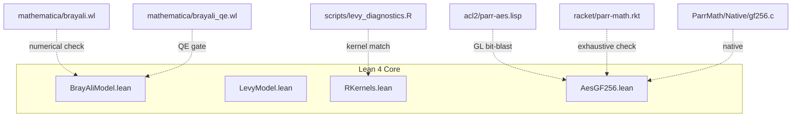
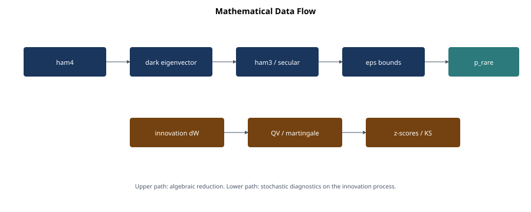

<!-- SPDX-License-Identifier: AGPL-3.0-only -->

# Bray-Ali Four-State Proton Model

A pure Lean 4 formalization of the linear algebra in N. Bray-Ali, *Spontaneous Mutations from Terahertz Proton Tunneling* (arXiv:2305.05624, v4), together with independent numerical and bit-blasted restatements of the same mathematics in Wolfram, R, Racket, ACL2, and C.

The repository makes no new physical or biological claim. It restates the published four-state Hamiltonian, its reduction to an effective two-level system, the associated rare-state probability bounds, and the Lévy-characterization diagnostics of the innovation process that appears in the stochastic filtering layer. Every statement is labeled by the evidence that supports it: a Lean proof, a numerical check that can be executed, or an interface axiom.

Parameter values quoted anywhere in the repository are those of arXiv:2305.05624v4 (\(U = 870\) meV, \(\Delta = 470\) meV).

- Toolchain: Lean 4.36.0 (`lean-toolchain`)
- Build: `lake build` (Init only; no Mathlib)
- License: AGPLv3

## 1. System identification

**Purpose.**  
Provide a machine-checkable account of the algebraic core of the Bray-Ali model and a set of independent checkers for the same quantities, so that any numerical claim can be reproduced or refuted without relying on a single implementation.

**Boundaries.**  
- In scope: the 4×4 Hamiltonian, the dark-state eigenvector, the three-state reduction, the secular cubic, the on-shell coupling bounds, the pure-dephasing innovation step, the quadratic-variation and martingale diagnostics, and the GF(2⁸) arithmetic used by the accompanying AES S-Box reference.  
- Out of scope: the biological interpretation of proton tunneling, open-system dynamics beyond pure dephasing, and any claim of physical prediction.

**Design principles.**  
1. Lean sources are the primary machine-checked artifact.  
2. Other languages are independent restatements of the same mathematics.  
3. No `sorry` appears in any Lean file.  
4. Evidence class is stated for every claim.

## 2. System architecture




The Lean core owns the algebraic identities and the diagnostic kernels. The remaining languages supply independent numerical or bit-blasted checks of selected components.

## 3. Repository directory architecture

| Path | Purpose | Language | Primary symbols | Verification |
|------|---------|----------|-----------------|--------------|
| `LevyCharacterization/BrayAliModel.lean` | Hamiltonian, reduction, eps bounds, innovation step | Lean | `ham4`, `ham4_dark_eigenvector`, `secularPoly`, `eps_exact_from_eigenvector`, `eps_lo_le_hi` | `lake build` |
| `LevyCharacterization/LevyModel.lean` | Innovation process and Lévy interface | Lean | `expMartingale`, `levy_characterization`, `innovation` | Interface axioms present |
| `LevyCharacterization/RKernels.lean` | Pure-Lean diagnostic kernels | Lean | `quadraticVariation`, `martingaleTransform`, `zScore`, `matchedResidual_eq_dW` | `lake build` |
| `LevyCharacterization/AesGF256.lean` | GF(2⁸) multiply and S-Box | Lean | `gfMul`, `gfInv`, `aesSbox` | Examples via `native_decide` |
| `mathematica/brayali.wl` | Wolfram reference implementation | Wolfram | `groundEnergy`, `pRareExact`, `levyReport` | Numerical when run |
| `mathematica/brayali_qe.wl` | Quantifier-elimination checks | Wolfram | eps-bound claims | Numerical when run |
| `scripts/levy_diagnostics.R` | R diagnostic script | R | QV, z-scores, kurtosis, KS | Numerical when run |
| `acl2/parr-aes.lisp` | ACL2 + GL field proofs | ACL2 | `gf-mul`, `gf-inv`, `aes-sbox` | Ready for `cert.pl` |
| `racket/parr-math.rkt` | Racket port | Racket | `gf-multiply`, `aes-sbox` | `raco test` |
| `ParrMath/` | Wolfram paclet + native C | Wolfram/C | `GFMultiply`, `gf256mul` | Numerical when run |

## 4. Mathematical foundations

### 4.1 Four-state Hamiltonian

In the ordered basis \(|GC\rangle, |G^*C^*\rangle, |G^+C^-\rangle, |G^-C^+\rangle\):

$$
H = \begin{pmatrix}
-\Delta/2 & 0 & -t & -t \\
0 & +\Delta/2 & -t & -t \\
-t & -t & U & 0 \\
-t & -t & 0 & U
\end{pmatrix}, \qquad t,\Delta,U > 0.
$$

Implemented as `ham4` in `BrayAliModel.lean`. The dark state

$$
|D\rangle = \frac{|G^+C^-\rangle - |G^-C^+\rangle}{\sqrt{2}}
$$

satisfies \(H|D\rangle = U|D\rangle\) (`ham4_dark_eigenvector`). The two neutral configurations communicate only through the charged intermediate.

### 4.2 Three-state reduction and secular equation

After projecting out the dark state the remaining subspace is described by `ham3`. The characteristic polynomial of the reduced problem is `secularPoly`. Roots of this cubic determine the exact on-shell coupling via `eps_exact_of_energy` and the rare-state probability via `p_rare_secular_of_energy`.

The paper’s approximate coupling (`kappa_paper`) and the on-shell coupling (`kappa_onshell`) are ordered by `kappa_onshell_le_paper`. Explicit lower and upper bounds replacing the paper’s approximation are given by `eps_bounds` and proved by `eps_lo_le_hi`.

### 4.3 Innovation process

The homodyne innovation is

$$
W_t = Y_t - \int_0^t \hat h_s \, ds.
$$

Lévy’s characterization theorem states that a continuous local martingale with unit quadratic variation is a Brownian motion. The diagnostic suite computes

- quadratic variation \(\sum_k (\Delta W_k)^2\) (`quadraticVariation`),
- the martingale transform \(\sum_k L_k \Delta W_k\) (`martingaleTransform`),
- the terminal second moment,
- increment kurtosis,
- a Kolmogorov–Smirnov statistic against \(\mathcal{N}(0,1)\).

`matchedResidual_eq_dW` records that a correctly specified filter recovers the driving increment. A misspecified filter is rejected by the martingale test while quadratic variation alone does not detect it.

### 4.4 RealField and ComplexOver

All algebraic reasoning is carried out inside a minimal ordered field with square root (`RealField`) and a complex extension (`ComplexOver`). No external real-number library is used. The derived lemmas (`add_zero`, `mul_one`, `neg_mul_left`, `div_cancel_mul`, …) are the only arithmetic steps available to the proofs.

## 5. Implementation architecture

### 5.1 Lean core

`BrayAliModel.lean` contains the field, the Hamiltonian matrices, the secular equation, the coupling bounds, the Lindblad probability factor, and the innovation step.  
`LevyModel.lean` contains the exponential martingale and the Lévy-characterization interface; several statements remain axioms at the module boundary.  
`RKernels.lean` contains the pure-Lean counterparts of every reduction performed by the R script, so that a Lean diagnostic record can be compared with an R record by the predicates `goodTagMatch` and `badTagMatch`.  
`AesGF256.lean` is an independent BitVec-8 implementation of the same GF(2⁸) multiply used by the S-Box, included solely for cross-check.

### 5.2 Cross-language suite

| Language | File | Role |
|----------|------|------|
| Wolfram | `mathematica/brayali.wl` | Secular solver, exact \(p_\text{rare}\), kappa comparison, `levyReport` |
| Wolfram | `mathematica/brayali_qe.wl` | Quantifier-elimination gate for the eps-bound claims |
| R | `scripts/levy_diagnostics.R` | Quadratic variation, z-scores, kurtosis, KS test |
| ACL2 | `acl2/parr-aes.lisp` | GL bit-blasting of commutativity, associativity, inversion, and S-Box injectivity |
| Racket | `racket/parr-math.rkt` | Exhaustive identity checkers over \(\{0,\dots,255\}\) |
| C | `ParrMath/Native/gf256.c` | Native 8-round shift-and-XOR multiply |

All GF(2⁸) implementations share the irreducible polynomial \(x^8 + x^4 + x^3 + x + 1\) (0x11B) and the same 8-round loop.

## 6. Interfaces

The Lean modules export only the definitions and theorems required by the model; there is no external API beyond the Lean module system.  
The R and Wolfram scripts consume CSV innovation records (produced by a companion exporter not present in this repository).  
The ACL2, Racket, and C implementations of GF(2⁸) share the reduction polynomial and the loop structure so that their known-answer tests can be compared directly.

## 7. Formal verification

| Property | Artifact | Status |
|----------|----------|--------|
| Dark state is eigenvector of energy \(U\) | `ham4_dark_eigenvector` | Proved |
| On-shell coupling from secular root | `eps_exact_from_eigenvector` | Proved |
| Ordering of paper vs. on-shell kappa | `kappa_onshell_le_paper` | Proved |
| Explicit eps bounds | `eps_lo_le_hi` | Proved |
| Correct filter recovers driving increment | `matchedResidual_eq_dW` | Proved |
| Lévy characterization interface | `levy_characterization` | Theorem under axiomatized hypotheses |
| GF(2⁸) field axioms | `acl2/parr-aes.lisp` (GL) | Ready for certification |
| Known-answer tests | Multiple languages | Consistent |

No end-to-end physical claim is verified.

## 8. Requirements traceability

| ID | Requirement | Implementation | Evidence |
|----|-------------|----------------|----------|
| SYS-001 | Restate the v4 Hamiltonian and dark-state identity | `ham4`, `ham4_dark_eigenvector` | Lean proof |
| SYS-002 | Derive explicit eps bounds from the secular cubic | `eps_bounds`, `eps_lo_le_hi` | Lean proof |
| SYS-003 | Supply pure-Lean diagnostic kernels matching the R script | `RKernels.lean` | Type-checked definitions |
| SYS-004 | Supply independent numerical checks of the same quantities | Wolfram, R | Scripts present |
| SYS-005 | Supply bit-blasted field axioms for the GF(2⁸) reference | `acl2/parr-aes.lisp` | File ready |
| VER-001 | Zero `sorry` in Lean sources | All `.lean` files | String search |

## 9. Build and toolchain

```bash
lake build
```

The Lean sources depend only on the Init library of Lean 4.36.0. No Mathlib is required.

Optional checks (interpreters not required for the Lean build):

```bash
Rscript scripts/levy_diagnostics.R
raco test racket/parr-math.rkt
cert.pl acl2/parr-aes.lisp   # requires ACL2 community books
```

## 10. Verification and validation

The Lean build is the primary verification step. It succeeds on a clean checkout. The R, Wolfram, and Racket scripts have not been executed in the environment that produced this repository; they remain available for independent execution. ACL2 certification has not been run here.

## 11. Limitations

- R and Wolfram scripts were written without those interpreters present.
- ACL2 certification was not executed in this environment.
- Several statements in `LevyModel.lean` remain axioms at the module interface.
- The biological reading of the model is taken from the source paper and is not examined.

## 12. Mathematical primitives (complete inventory)

### RealField lemmas
`add_zero`, `mul_one`, `mul_zero`, `right_distrib`, `sub_self`, `neg_mul_left`, `mul_neg_right`, `neg_one_mul`, `add_neg_cancel_right`, `pos_ne_zero`, `nonneg_mul_sq_two`, `sub_le_self_of_nonneg`, `le_add_of_nonneg_right`.

### Hamiltonian and reduction
`ham4`, `ham4_symmetric`, `darkVec4`, `ham4_dark_eigenvector`, `ham3`, `ham3_symmetric`, `secularPoly`, `eps_exact_of_energy`, `p_rare_secular_of_energy`, `eps_exact_from_eigenvector`, `kappa_paper`, `kappa_onshell`, `kappa_onshell_le_paper`, `eps_bounds`, `eps_lo_le_hi`, `lindblad_prob_factor`.

### Complex arithmetic
`ComplexOver`, `cAdd_zero`, `cMul_one`, `cMul_zero`, `cSub_self`, `cNeg_mul_left`, `cMul_neg_right`, `cNeg_one_mul`, `cNeg_neg`, `cNeg_add`.

### Diagnostic kernels
`vecSum`, `vecMean`, `vecStd`, `zScore`, `quadraticVariation`, `martingaleTransform`, `terminalValue`, `wSquaredMartingale`, `incrementKurtosis`, `excessKurtosis`, `levyDiagnostics`, `matchedResidual`, `matchedResidual_eq_dW`, `goodTagMatch`, `badTagMatch`, `bothTagsMatch`, `rZ`, `rZ_eq_zScore`, `runOnRecord`, `compareToR`.

### Lévy interface
`expMartingale`, `expMartingale_factor` (axiom), `cond_charfun_of_levy_hypotheses` (axiom), `levy_characterization`, `hHat`, `innovation`, `innovation_zero` (axiom), `innovation_is_brownian` (axiom), `drift_has_unit_quadVar` (axiom), `scaled_is_martingale`, `scaled_not_unit_quadVar` (axiom), `scaled_not_brownian`.

### GF(2⁸)
`gfXtime`, `gfMulLoop`, `gfMul`, `gfInv`, `aesAffine`, `aesSbox`.

## 13. Glossary

| Term | Meaning |
|------|---------|
| Dark state | Antisymmetric combination of the two charged configurations; exact eigenvector of energy \(U\). |
| On-shell coupling | Effective coupling obtained after eliminating the charged intermediate under the secular-equation constraint. |
| Innovation process | Residual of the homodyne record after subtraction of the filtered expectation. |
| Lévy characterization | Continuous local martingale + unit quadratic variation implies Brownian motion. |
| GF(2⁸) | Finite field with irreducible polynomial \(x^8+x^4+x^3+x+1\). |

## 14. References

- Bray-Ali, N. *Spontaneous Mutations from Terahertz Proton Tunneling*. arXiv:2305.05624v4.
- FIPS-197, Advanced Encryption Standard (S-Box test vectors).

## 15. License

GNU Affero General Public License v3.0. See `LICENSE`. Every source file carries an SPDX header.

Cite the source paper together with the commit hash of this repository.

---



*All claims above are traceable to the source paths and Lean identifiers listed in the tables.*
