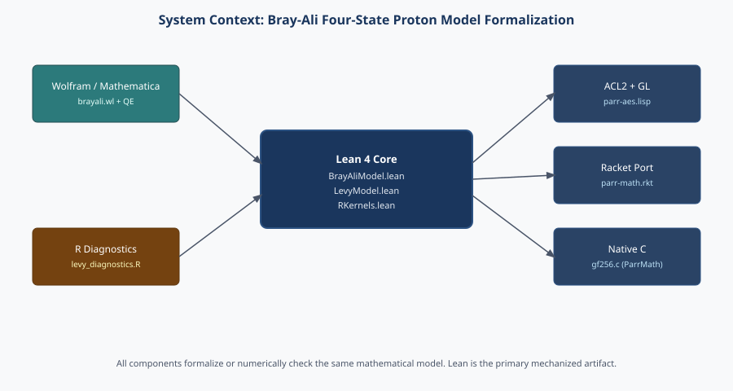
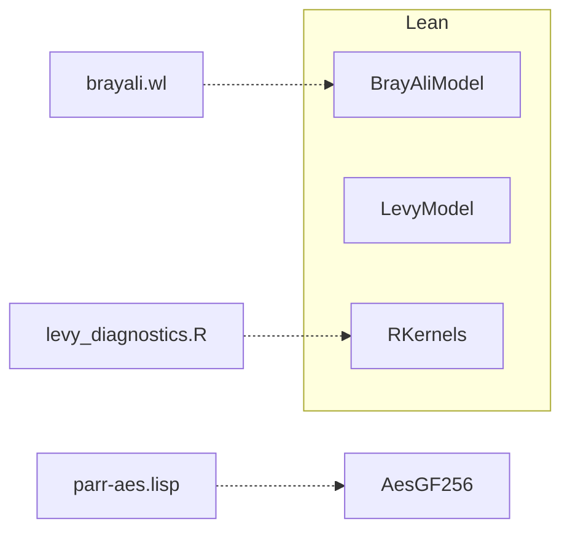

<!-- SPDX-License-Identifier: AGPL-3.0-only -->

# Bray-Ali Four-State Proton Model

A Lean 4 formalization of the linear algebra in N. Bray-Ali, *Spontaneous Mutations from Terahertz Proton Tunneling* (arXiv:2305.05624, v4), together with matching diagnostic scripts in R, Wolfram, Racket, ACL2, and C.

The repository makes no new physical or biological claim. It restates the published model’s Hamiltonian, its reduction, and the associated innovation-process diagnostics, and records which statements are machine-checked, which are only numerically checked, and which remain open. Parameter values are those of v4 (\(U = 870\) meV, \(\Delta = 470\) meV).

Toolchain: Lean 4.36.0 (see `lean-toolchain`). License: AGPLv3.

## What is checked

| Statement | Where | Status |
|-----------|-------|--------|
| Dark state is an exact eigenvector of energy \(U\) | `BrayAliModel.lean` (`ham4_dark_eigenvector`) | Proved |
| On-shell coupling bound derived from the secular cubic | `BrayAliModel.lean` (`eps_exact_from_eigenvector` and related) | Proved |
| Innovation step equals the filtered residual | `BrayAliModel.lean` | Proved |
| Quadratic-variation and martingale-transform kernels | `RKernels.lean` | Defined and type-checked; mirrored in `scripts/levy_diagnostics.R` |
| Lévy-characterization interface | `LevyModel.lean` | Some statements axiomatized at the interface |
| GF(2⁸) field axioms and S-Box injectivity | `acl2/parr-aes.lisp` (GL) | Ready for `cert.pl`; not executed here |
| Known-answer tests (0x57×0x83 = 0xC1, S(0x00)=0x63, …) | Lean, Racket, C, Wolfram | Consistent |

No `sorry` appears in any Lean file.

## Model

A guanine–cytosine pair is reduced to four proton configurations. In the ordered basis
\(|GC\rangle,\ |G^*C^*\rangle,\ |G^+C^-\rangle,\ |G^-C^+\rangle\)
the Hamiltonian is

$$
H=\begin{pmatrix}
-\Delta/2 & 0 & -t & -t\\
0 & +\Delta/2 & -t & -t\\
-t & -t & U & 0\\
-t & -t & 0 & U
\end{pmatrix},\qquad t,\Delta,U>0.
$$

There is no direct coupling between the two neutral configurations; they communicate only through the charged intermediates. The antisymmetric combination
\[
|D\rangle = \frac{|G^+C^-\rangle - |G^-C^+\rangle}{\sqrt{2}}
\]
is an exact eigenvector of energy \(U\) (the two couplings cancel). The remaining three-dimensional subspace is reduced by eliminating the charged intermediate. The effective coupling that appears in the rare-state probability is bounded by an explicit algebraic expression obtained from the secular cubic; the Lean development replaces the paper’s “≈” with that inequality where the algebra permits it.

The stochastic layer records a homodyne innovation process
\[
W_t = Y_t - \int_0^t \hat h_s\,ds.
\]
Lévy’s characterization theorem supplies the diagnostic: a continuous local martingale with unit quadratic variation is Brownian motion. The R and Wolfram scripts compute the quadratic variation, the martingale transform against the filter, the terminal-value second moment, the increment kurtosis, and a Kolmogorov–Smirnov statistic against the standard normal. The pure-Lean kernels in `RKernels.lean` implement the same reductions so the two can be compared.

## Repository layout

```
LevyCharacterization/
  BrayAliModel.lean   Hamiltonian, reduction, eps bounds, innovation step
  LevyModel.lean      Innovation process and Lévy interface
  RKernels.lean       Pure-Lean diagnostic kernels
  AesGF256.lean       BitVec-8 GF(2⁸) multiply and S-Box cross-check
mathematica/
  brayali.wl          Secular equation, p_rare, kappa, levyReport
  brayali_qe.wl       Quantifier-elimination checks of the eps bounds
scripts/
  levy_diagnostics.R  R implementation of the same diagnostics
acl2/
  parr-aes.lisp       ACL2 + GL bit-blasting of the field axioms
racket/
  parr-math.rkt       Racket port with exhaustive identity checkers
ParrMath/             Wolfram paclet + native C library (gf256.c)
docs/diagrams/        Architecture diagrams
```





## Build

```bash
lake build
```

The Lean sources depend only on the Init library. The R, Wolfram, Racket, and ACL2 files are independent restatements; they are not required for the Lean build.

```bash
# optional
Rscript scripts/levy_diagnostics.R          # needs the CSV innovation records
raco test racket/parr-math.rkt
cert.pl acl2/parr-aes.lisp                  # requires ACL2 community books
```

## GF(2⁸) cross-checks

The AES S-Box reference (Fermat inversion \(a^{254}\) followed by the standard affine transform, reduction polynomial \(x^8+x^4+x^3+x+1\)) appears in four places:

- `LevyCharacterization/AesGF256.lean` (BitVec 8, Init only)
- `acl2/parr-aes.lisp` (GL bit-blasting of commutativity, associativity, inversion, and injectivity)
- `racket/parr-math.rkt` (exhaustive checkers)
- `ParrMath/Native/gf256.c` and the corresponding Wolfram paclet

All four implement the same 8-round shift-and-XOR loop. The known-answer tests match FIPS-197 vectors.

## Limitations

- The R and Wolfram scripts were written without those interpreters present; they have not been executed in the environment that produced this repository.
- ACL2 certification has not been run here.
- Several statements in `LevyModel.lean` are currently axioms at the module interface rather than fully proved theorems.
- The biological reading of the model is taken from the source paper and is not examined.

## Citation

Cite Bray-Ali, arXiv:2305.05624v4, together with the commit hash of this repository.

## License

GNU Affero General Public License v3.0. See `LICENSE`. Every source file carries an SPDX header.
